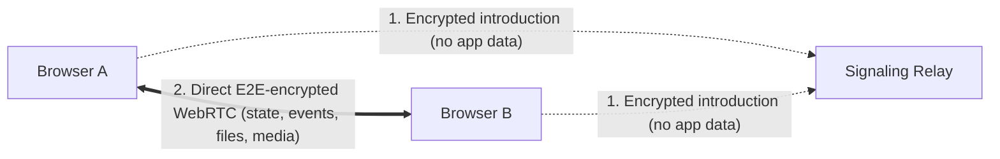

# ✨🤝✨ Trystero

**Instant peer-to-peer multiplayer for the web — no server required.**

👉 **[Try it live on trystero.dev](https://trystero.dev)** 👈

Turning a weekend web project into a multiplayer app usually means a detour into
backend land: spinning up WebSocket servers, wiring up user accounts, managing
database state, and paying to keep something running just so two browsers can
say hello.

**Trystero skips the server entirely.** Import it into any static site, join a
room by name, and browsers discover each other automatically and connect
directly over fast, end-to-end encrypted WebRTC. Out of the box, you get
verified user identities, synced player and room state, host permissions, RPC,
chunked file transfers, and live audio/video — so you can ship a real
multiplayer game or collaborative tool from GitHub Pages, Neocities, or a single
HTML file.

---

## Quickstart

Install Trystero from npm:

```sh
npm i trystero
```

Or skip the build step and import straight from an ESM CDN:

```html
<script type="module">
  import {joinRoom} from 'https://esm.run/trystero'
</script>
```

Join a room by name and start syncing state — here's a complete multiplayer
cursor canvas in a dozen lines:

```js
import {joinRoom} from 'trystero'

// No API keys, accounts, or backend setup — pick a globally unique appId
// (e.g. your app's domain or 'username/app-name') and a room name
const room = joinRoom({appId: 'pixel-party.example.com'}, 'studio-42')

// Give every user their own signed state slot
const cursor = room.makeUserState('cursor', {x: 0, y: 0})

window.addEventListener('pointermove', e => {
  cursor.set({x: e.clientX, y: e.clientY})
})

cursor.onChange((pos, {userId, self, removed}) => {
  if (self) return
  if (removed) removeCursor(userId)
  else drawCursor(userId, pos)
})
```

Open your page in two browsers anywhere in the world and watch the cursors move.

> **Local testing tip:** Tabs in the same browser profile share your `userId`
> automatically. Open a Private/Incognito window (or pass `identity: 'none'`)
> when simulating a second person on one machine.

---

## How it works (with zero backend)

WebRTC lets browsers talk directly to each other, peer-to-peer, without routing
traffic through a central server. The one catch with WebRTC has always been
_signaling_: two browsers need a brief introduction to swap connection info
before they can link up.

Trystero handles that introduction automatically out of the box using public
relays — nothing to deploy or configure. Once peers connect, **your app's data
never touches a relay**: state, messages, files, and media flow straight from
browser to browser, end-to-end encrypted.



Prefer to run discovery over your own Supabase or Firebase project, MQTT,
BitTorrent, or a tiny self-hosted WebSocket relay? You can swap strategies with
a one-line import change — see the
**[Signaling & Relays guide](./docs/signaling.md)**.

<details>
  <summary>Peek under the hood: how serverless discovery and security work</summary>

- **Encrypted signaling**: Connection offers (SDPs) are encrypted with
  AES-256-GCM before touching any relay. Adding a room `password` derives the
  key via WebCrypto `PBKDF2-SHA256` (600,000 iterations) so outsiders and relay
  operators can't read handshakes or join the room.
- **Self-certifying identities**: Every user (`userId`) and browser tab
  (`peerId`) is derived from a WebCrypto ECDSA P-256 public keypair. During
  connection setup, peers verify each other's keys against the WebRTC DTLS
  certificate fingerprint
  ([RFC 8827](https://www.rfc-editor.org/rfc/rfc8827.html)), preventing spoofing
  and man-in-the-middle relays.
- **Signed state & roles**: Updates to `makeUserState`, `makeState`, and
  `roles()` carry cryptographic signatures and Hybrid Logical Clock timestamps,
  allowing peers (including late joiners) to verify who wrote what without a
  central server.

</details>

---

## What you can build with it

### 1. Synced player & room state

Most multiplayer apps need two kinds of live state: **per-player state** that
each participant owns (names, avatars, ready flags, cursors) and **shared room
state** for the group (a game board, round timer, or watch-party queue).

Trystero builds both right onto `room`. Updates apply immediately locally,
coalesce rapid writes on the wire, verify who wrote them, and sync automatically
to late joiners — even if the person who last updated shared state has already
closed their laptop.

```js
// Each player controls only their own signed slot — nobody can overwrite yours
const profile = room.makeUserState('profile', {name: 'Anon', ready: false})
profile.set({name: 'Oedipa', ready: true})

// Snapshot of everyone currently in the room: { [userId]: { name, ready } }
console.log(profile.getAll())

// Shared state for the whole room, synced automatically to latecomers
const track = room.makeState('track', {url: 'chill-beat.mp3', paused: true})

track.onChange((next, {userId}) => {
  syncAudioPlayer(next)
  console.log(`Updated by ${userId}`)
})

await track.set(prev => ({...prev, paused: false}))
```

Using **React**? Both `makeUserState` and `makeState` plug straight into
`useSyncExternalStore` — no `useEffect` glue or manual join/leave maps:

```jsx
import {useSyncExternalStore} from 'react'

function Lobby() {
  const players = useSyncExternalStore(profile.onChange, profile.getAll)
  const nowPlaying = useSyncExternalStore(track.onChange, track.get)
  // render directly from `players` and `nowPlaying`
}
```

👉 **[Shared & Per-User State guide →](./docs/state.md)**

---

### 2. Unforgeable user identity, passwords & room caps

Every participant gets a persistent, cryptographically verified `userId` out of
the box — no login screens or auth servers required. If someone refreshes the
page or opens your app in two tabs at once, Trystero recognizes them as the same
user automatically. (Want strictly throwaway IDs or keys loaded from your own
backend? One config option switches modes.)

Combine `password` and `maxUsers` to spin up private, seat-capped matches like a
2-player chess table or a 4-player co-op lobby:

```js
const room = joinRoom(
  {
    appId: 'chess.example.com',
    password: 'knight-takes-f7-secret', // encrypts discovery so outsiders stay out
    maxUsers: 2 // cap this match at 2 unique players (you + 1 opponent)
  },
  'table-7'
)

const {userId} = await room.getSelf()

room.onUserJoin(({userId}) => console.log(`Opponent ${userId} sat down`))
room.onUserLeave(({userId}) => console.log(`Opponent ${userId} left`))

room.onError(err => {
  if (err.code === 'room-full' && Object.keys(room.getPeers()).length === 0) {
    showBanner('Sorry, both seats at this table are taken!')
  }
})
```

👉 **[Identity, Presence & Room Access guide →](./docs/identity.md)**

---

### 3. Serverless hosts, custom roles & moderation

In a typical P2P app, everyone is equal — which gets awkward the moment someone
opens DevTools in your trivia game and awards themselves a million points.

Import the tree-shakeable `roles()` plugin to create rooms with mathematically
verified admins, custom roles (like `'dj'` or `'moderator'`), authoritative
state that only authorized roles can edit, and peer banning — still with zero
backend:

```js
import {joinRoom, roles} from 'trystero'

// Host creates a room where their userId has verified admin authority
const room = joinRoom(
  {appId: 'oedipa/friday-trivia', use: [roles({selfAsAdmin: true})]},
  'quiz-night'
)

// Share `roomId` (e.g. "quiz-night~9fX2kLm...") in an invite link;
// guests join with `use: [roles()]` and automatically verify the host
const {roomId} = await room.getSelf()

// With roles() enabled, makeState defaults to admin-only writes —
// everyone can read `game`, and peers reject forged edits automatically
const game = room.makeState('game', {round: 1, prompt: 'Ready?'})
await game.set({round: 2, prompt: 'Name the moons of Mars'})

// Promote helpers or boot troublemakers
await room.grantRole(friendId, 'cohost')
await room.ban(grieferId, {reason: 'spoiling answers'})
```

👉 **[Admins, Roles & Moderation guide →](./docs/roles.md)**

---

### 4. Events, RPC & direct P2P file drop

For ephemeral events, request/response calls, and binary transfers, create typed
channels with `room.makeAction()`. Pass strings, JSON objects, `Blob`s, `File`s,
or `TypedArray`s — Trystero handles serialization, chunking, backpressure,
metadata headers, and transfer progress automatically, with zero cloud storage
bills:

```js
// Direct browser-to-browser file sharing with size checks & progress bars
const drop = room.makeAction('file-drop')

drop.onReceive(({byteLength}) => byteLength <= 100 * 1024 ** 2)
drop.onReceiveProgress((pct, {metadata}) => showDownloadBar(metadata.name, pct))
drop.onMessage((bytes, {userId, metadata}) => saveFile(bytes, metadata.name))

await drop.send(file, {
  metadata: {name: file.name},
  onProgress: pct => showUploadBar(pct)
})

// 1-to-1 or fan-out request/response RPC
const roll = room.makeAction('roll-check', {kind: 'request'})
roll.onRequest(() => Math.ceil(Math.random() * 20))

const result = await roll.request(null, {target: friendId, timeoutMs: 2000})
```

👉 **[Actions, RPC & File Transfers guide →](./docs/actions.md)**

---

### 5. Voice, video & screen sharing

Drop live audio, webcam video, screen captures, or Web Audio streams into any
room, and tag streams with `metadata` so peers can tell a facecam from a screen
share:

```js
const stream = await navigator.mediaDevices.getUserMedia({
  audio: true,
  video: true
})

// Send to everyone here now, plus anyone who joins later
await room.addStream(stream, {metadata: {type: 'webcam'}})
room.onUserJoin(({userId}) =>
  room.addStream(stream, {target: userId, metadata: {type: 'webcam'}})
)

room.onPeerStream((remoteStream, {userId, metadata}) => {
  attachVideo(userId, remoteStream, metadata.type)
})
```

👉 **[Audio, Video & Screen Sharing guide →](./docs/media.md)**

---

### 6. Scale to dozens of peers (`scale()`)

Standard WebRTC connects every browser directly to every other browser, which is
ideal for small hangouts and matches. Building a 40-person collaborative canvas
or a crowded party lobby? Opt into the tree-shakeable `scale()` plugin
_(experimental)_:

```js
import {joinRoom, scale} from 'trystero'

const room = joinRoom({appId: 'canvas.example.com', use: [scale()]}, 'plaza')
```

Small rooms stay in a fast direct mesh with zero extra overhead; as more people
pile in, Trystero automatically forms a multi-hop gossip network so no single
browser gets overwhelmed — while your state, action, and media code stays
exactly the same.

👉 **[Scaling Large Rooms guide →](./docs/scaling.md)**

---

### 7. Run headless peers in Node, Bun & Deno

Trystero runs outside the browser too. Drop a lightweight peer onto a Raspberry
Pi, build a game bot, or run a silent `passive: true` peer on a tiny box to keep
shared room state warm even when every browser tab closes:

```js
import {joinRoom} from 'trystero'
import {RTCPeerConnection} from 'werift'

const room = joinRoom(
  {appId: 'oedipa/synth-jam', rtcPolyfill: RTCPeerConnection, passive: true},
  'room-1'
)

// Silently caches and syncs the latest pattern for newcomers
room.makeState('pattern', {bpm: 120, steps: []})
```

👉 **[Running in Node, Bun & Deno guide →](./docs/server-side.md)**

---

## Documentation

Dive deeper into any feature or browse the full API:

| Guide                                                            | What's inside                                                                                                                 |
| ---------------------------------------------------------------- | ----------------------------------------------------------------------------------------------------------------------------- |
| **[Shared & Per-User State](./docs/state.md)**                   | `makeUserState`, `makeState`, validation rules, late-joiner sync, and React (`useSyncExternalStore`)                          |
| **[Identity, Presence & Room Access](./docs/identity.md)**       | `userId` vs `peerId`, multi-tab presence, custom identity keys, room `password`s, `maxUsers`, and `onError`                   |
| **[Admins, Roles & Moderation](./docs/roles.md)**                | `roles()`, self-certifying rooms, fixed admins, custom roles, authoritative state, and banning                                |
| **[Actions, RPC & File Transfers](./docs/actions.md)**           | `makeAction`, `send`, `request` & `requestMany`, TypeScript types, binary metadata, progress bars, and `onReceive`            |
| **[Audio, Video & Screen Sharing](./docs/media.md)**             | `addStream`, `onPeerStream`, `removeStream`, camera/screen switching (`replaceTrack`), and stream metadata                    |
| **[Scaling Large Rooms](./docs/scaling.md)**                     | Multi-hop routing with `scale()`, direct media/file promotion, and `getTopology()`                                            |
| **[Signaling & Relays](./docs/signaling.md)**                    | Default zero-config relays, Supabase, Firebase, MQTT, BitTorrent, self-hosted `ws-relay`, custom strategies, and bundle sizes |
| **[Running in Node, Bun & Deno](./docs/server-side.md)**         | Headless peers, Raspberry Pi / IoT setups, and `passive` state backup peers                                                   |
| **[NAT Traversal & Troubleshooting](./docs/troubleshooting.md)** | Configuring TURN servers, diagnosing strict firewalls, and `ping()`                                                           |
| **[Full API Reference](./docs/api.md)**                          | Complete function signatures, TypeScript types, config options, and error codes                                               |
| **[Upgrading to 0.27.0](./MIGRATION.md)**                        | Architectural overview, breaking changes, and before/after migration examples                                                 |

---

## Community

Curious what people are tinkering on? Check out projects built by the community
in **[awesome-trystero](https://github.com/jeremyckahn/awesome-trystero)**, or
take it for a spin on **[trystero.dev](https://trystero.dev)**.

---

Trystero by [Dan Motzenbecker](https://oxism.com)
