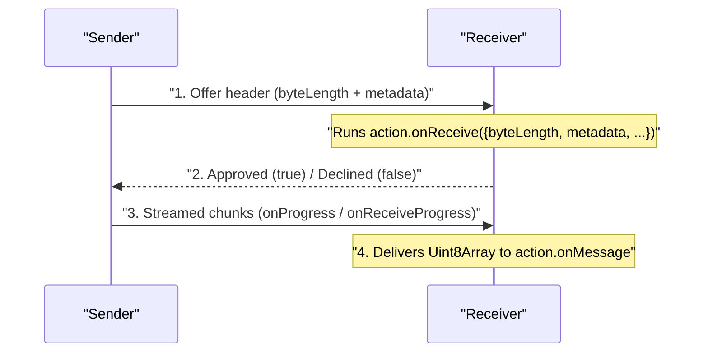

# Actions, RPC & File Transfers

[← Back to README](../README.md) · [API Reference](./api.md)

While [`makeUserState` and `makeState`](./state.md) keep persistent values in
sync for the room, **`room.makeAction()`** handles everything transient or
large:

- **One-way events**: Chat messages, sound-effect triggers, damage hits, drawing
  strokes
- **Request / response RPC**: Asking one peer (or polling everyone) for an
  answer with timeouts
- **Binary & file transfers**: Streaming `Blob`s, `File`s, `ArrayBuffer`s, and
  `TypedArray`s of arbitrary size directly browser-to-browser with metadata and
  progress bars

---

## Sending & receiving messages

Create a named action (`1–32` UTF-8 bytes) with `room.makeAction(namespace)`:

```js
import {joinRoom} from 'trystero'

const room = joinRoom({appId: 'cantina'}, 'table-4')
const drink = room.makeAction('drink')

// Broadcast to everyone currently in the room
await drink.send({name: 'mezcal', withIce: false})

// Or send to a specific user (or array of users / tabs)
await drink.send({name: 'negroni', withIce: true}, {target: friendUserId})

// Listen for incoming drinks
const unsub = drink.onMessage((data, {userId, peerId, roles}) => {
  console.log(
    `${userId} sent a ${data.name} ${data.withIce ? 'on the rocks' : 'neat'}`
  )
})
```

Whatever type you send arrives on the other side with its type preserved:
strings arrive as strings, numbers/booleans/objects/arrays as parsed JSON, and
binary data (`Blob`, `File`, `ArrayBuffer`, or `TypedArray`) as a `Uint8Array`.

### TypeScript generics

Pass payload types directly to `makeAction`:

```ts
type Stroke = {points: [number, number][]; brushSize: number}

const stroke = room.makeAction<Stroke>('stroke')
```

For request/response actions, pass both the request and response types:

```ts
const checkVersion = room.makeAction<{client: string}, {compatible: boolean}>(
  'version',
  {kind: 'request'}
)
```

---

## Request / response RPC (`kind: 'request'`)

When you need a reply rather than a fire-and-forget broadcast, pass
`{kind: 'request'}`:

```js
const rollCheck = room.makeAction('roll-check', {kind: 'request'})

// Register a handler (returns a value or a Promise)
rollCheck.onRequest(({stat}, {userId}) => {
  console.log(`${userId} requested a ${stat} check`)
  return Math.ceil(Math.random() * 20) + characterSheet[stat]
})

// Ask a single user (automatically routes to one of their active tabs)
const roll = await rollCheck.request(
  {stat: 'stealth'},
  {target: playerUserId, timeoutMs: 3000}
)
```

- Because a request produces a single reply, **only one `onRequest` handler can
  be active per action at a time** (call the returned `unsubscribe()` function
  before replacing it).
- Throwing an `Error` inside `onRequest` rejects the caller's `request()`
  promise with an `ActionError` (`err.kind === 'rejected'`) and forwards your
  `error.message`.

### Polling multiple users at once (`requestMany`)

Want to ask a whole team or room a question at the same time? `requestMany()`
queries every target in parallel, lets you react incrementally via `onResult` as
each reply comes back, and resolves with a labeled result array when everyone
settles:

```js
const readyCheck = room.makeAction('ready-check', {kind: 'request'})

readyCheck.onRequest(() => isPlayerReady())

const results = await readyCheck.requestMany(null, {
  targets: Object.keys(room.getUsers()),
  timeoutMs: 5000,
  onResult: res => {
    if (res.status === 'fulfilled') {
      markCheckmark(res.userId, res.value)
    }
  }
})

const readyUsers = results
  .filter(r => r.status === 'fulfilled' && r.value === true)
  .map(r => r.userId)
```

Each item in `results` has `{userId, peerId, status}` where `status` is
`'fulfilled'` (with `value`), `'timeout'`, `'disconnected'`, or `'rejected'`
(with `error`).

---

## Direct P2P file transfers, metadata & progress bars

Actions automatically chunk and pace large payloads behind the scenes, so
sending a 150 MB `.zip` or `.flac` file uses the exact same API as sending a
chat message — without paying a cent for S3 buckets or upload bandwidth.

### Attaching `metadata` to binary data

Pass any JSON-serializable `metadata` object alongside binary payloads so the
receiver knows the filename, MIME type, or transfer ID before the bytes even
finish arriving:

```js
const fileDrop = room.makeAction('file')

// Attach `onReceive` before `onMessage` to inspect size & metadata up front
fileDrop.onReceive(({byteLength, metadata, userId}) => {
  console.log(`Incoming ${metadata.name} (${byteLength} bytes) from ${userId}`)
  return byteLength <= 100 * 1024 ** 2 // approve files up to 100 MiB
})

// Show a live download progress bar (0 to 1)
fileDrop.onReceiveProgress((percent, {userId, metadata}) => {
  updateDownloadBar(userId, metadata.id, metadata.name, percent)
})

// Receive the reassembled bytes as a Uint8Array
fileDrop.onMessage((bytes, {userId, metadata}) => {
  const url = URL.createObjectURL(new Blob([bytes], {type: metadata.type}))
  triggerBrowserDownload(url, metadata.name)
})

// Send a File from an <input type="file"> with an upload progress bar
await fileDrop.send(selectedFile, {
  target: [friendA, friendB],
  metadata: {
    id: crypto.randomUUID(),
    name: selectedFile.name,
    type: selectedFile.type
  },
  onProgress: (percent, {userId}) => {
    updateUploadBar(userId, percent)
  }
})
```

> **Important:** When sending binary buffers larger than `16 KiB` (`ArrayBuffer`
> or `TypedArray`), Trystero reads chunks directly from your buffer without
> making an extra copy in memory. Don't mutate that buffer until the `Promise`
> returned by `send()` settles!

### Gating incoming files & adjusting the room receive budget



- **`action.onReceive(fn)`**: Return `true` or `false` (or a `Promise<boolean>`,
  e.g. after prompting the user with an "Accept file from Alice?" dialog). For
  chunked transfers, the sender waits for approval before streaming file
  contents; if you return `false`, the sender's `send()` rejects with
  `err.kind === 'rejected'`. Use `context.signal` inside `onReceive` to dismiss
  a pending prompt if the sender cancels or disconnects.
- **`maxReceiveBytes` (default `256 MiB`)**: Each room enforces a `256 MiB`
  concurrent receive budget out of the box (incoming files are reassembled in
  memory, and extra concurrent transfers queue automatically when the budget is
  full). Raise or lower it in `joinRoom({appId, maxReceiveBytes: ...}, roomId)`.

---

## Cancelling transfers & handling errors

### Cancelling with `AbortSignal`

Pass an `AbortController`'s `signal` to `send()`, `request()`, or
`requestMany()` to cancel an in-flight transfer or RPC call:

```js
const controller = new AbortController()
cancelButton.onclick = () => controller.abort()

await fileDrop.send(bigFile, {signal: controller.signal})
```

### Promise resolution & `ActionError`

- **Broadcast `send(data)`** (no `target`): Resolves once local sending finishes
  (or immediately if nobody else is in the room yet).
- **Targeted `send(data, {target})`**: Validates all targets up front and
  rejects if any targeted `userId` or `peerId` is not currently connected.
- **Structured `ActionError`**: Failed `send()` and `request()` calls reject
  with an `Error` carrying `err.kind`:
  - `'timeout'` — `request()` exceeded `timeoutMs` or transfer stalled
  - `'disconnected'` — target wasn't connected or left mid-transfer
  - `'aborted'` — cancelled via your `AbortSignal`
  - `'rejected'` — receiver declined via `onReceive`, or `onRequest` threw an
    `Error`

### Role-restricted actions

Using the [`roles()`](./roles.md) plugin? Pass `roles: ['admin', 'moderator']`
in `room.makeAction(namespace, {roles})` so only verified holders of those roles
can send messages or initiate requests on that channel.

<details>
  <summary>Deep dive: v3 wire frames, pre-listener buffering & multi-hop promotion</summary>

- **Compact v3 binary framing**: Every action frame starts with a 36-byte inline
  header (or 48-byte chunked offer header) carrying protocol version `3`, frame
  kind (`inline`, `offer`, `chunk`, `accepted`, `rejected`, `cancelled`),
  payload format (`text`, `json`, `binary`), the 32-byte UTF-8 action name, and
  a 16-bit metadata length. Small payloads that fit inside a single WebRTC frame
  (`16 KiB` max frame budget including header and metadata) transmit in one shot
  with zero round-trip setup; larger payloads negotiate an `offer` → `accepted`
  handshake and stream `chunk` frames paced by `RTCDataChannel.bufferedAmount`.
- **Early-arrival buffering**: When a peer connects and fires a quick greeting
  message before your component finishes mounting its `action.onMessage(...)`
  listener, Trystero buffers up to `32` inline messages per sending peer for up
  to `10` seconds on registered actions (without consuming the chunked receive
  budget) and drains them in order to the first subscriber.
- **Multi-hop direct promotion**: In [`scale()`](./scaling.md) rooms, inline
  messages (`<= 16 KiB`) route directly across the encrypted multi-hop gossip
  overlay, while multi-chunk transfers (`> 16 KiB`) automatically promote the
  recipient to a direct 1-hop WebRTC connection on demand so intermediate
  browser peers never spend bandwidth relaying someone else's large files.

</details>
