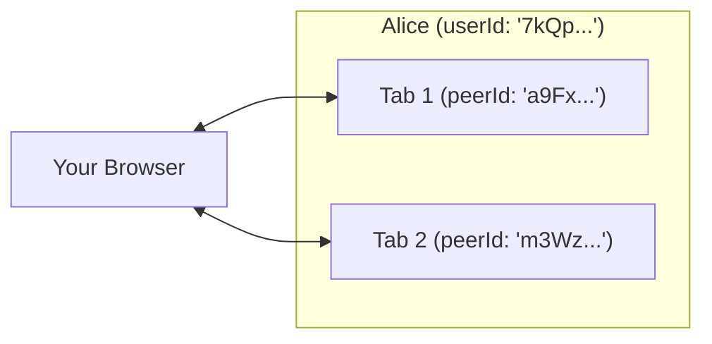

# Identity, Presence & Room Access

[← Back to README](../README.md) · [API Reference](./api.md)

Building a multiplayer app without a server usually raises three immediate
questions:

1. _How do I tell users apart without forcing them through a signup screen?_
2. _What happens when someone refreshes the page or opens two tabs at once?_
3. _How do I keep a private match private or cap a 2-player game at two seats?_

Trystero handles all three out of the box.

---

## Automatic, unforgeable user identities (`userId`)

Every participant in Trystero gets a verified 22-character `userId`
automatically — no accounts, cookies, OAuth redirects, or backend database
required. Because each `userId` is derived from a public keypair and verified
during the WebRTC handshake, nobody can spoof or hijack another player's ID.

Inspect your own identity and room details at any time with `room.getSelf()`:

```js
import {joinRoom} from 'trystero'

const room = joinRoom({appId: 'tabletop.example.com'}, 'room-42')
const {userId, peerId, identityPersistence} = await room.getSelf()

console.log(`I am user ${userId} on tab ${peerId} (${identityPersistence})`)
```

### Choosing how `userId` persists (`config.identity`)

In browsers, `userId` persists across page refreshes, open tabs, and future
visits on that device by default (`identity: 'local'`). You can switch modes
with a single config property:

| `identity` value                       | How `userId` behaves                                                                                                                                       |
| -------------------------------------- | ---------------------------------------------------------------------------------------------------------------------------------------------------------- |
| **`'local'`** _(browser default)_      | Stored per `appId` in `IndexedDB` and shared across all tabs and future visits on that device until `clearUserIdentity(appId)` or site storage is cleared. |
| **`'none'`** _(Node/Bun/Deno default)_ | Strictly ephemeral — every page reload, new tab, or process restart gets a fresh `userId` with nothing saved to disk.                                      |
| **`UserIdentity` or async loader**     | Bring your own portable identity key from your backend, account system, or local file so a user keeps the exact same `userId` across laptop and phone.     |

#### Ephemeral mode (no browser storage)

```js
const room = joinRoom({appId: 'oedipa/sketchpad', identity: 'none'}, 'canvas-1')
```

#### Resetting a stored browser identity ("Sign out")

```js
import {clearUserIdentity} from 'trystero'

await room.leave()
await clearUserIdentity('tabletop.example.com')
```

#### Portable identities across devices (custom storage / backend)

Want a logged-in user to keep the same `userId` on both their laptop and phone
(or save a bot's identity to disk in Node)? Use `createUserIdentity`,
`exportUserIdentity`, and `importUserIdentity`:

```js
import {
  joinRoom,
  createUserIdentity,
  exportUserIdentity,
  importUserIdentity
} from 'trystero'

const room = joinRoom(
  {
    appId: 'rpg.example.com',
    identity: async ({appId, roomId}) => {
      const savedKey = await fetchKeyFromYourBackend(appId)
      if (savedKey) {
        return importUserIdentity(savedKey)
      }

      const fresh = await createUserIdentity()
      await saveKeyToYourBackend(appId, exportUserIdentity(fresh))
      return fresh
    }
  },
  'tavern-1'
)
```

> **Local testing tip:** Because `'local'` shares your `userId` across tabs in
> the same browser profile, open an Incognito/Private window (or temporarily set
> `identity: 'none'`) when pretending to be two different people on one laptop.

---

## Users vs. tabs (`userId` vs `peerId`)

Why does Trystero expose both a `userId` and a `peerId`?

Because real people open multiple tabs. If Alice has your app open in two
browser tabs (or on her laptop and phone with a synced identity), each tab has
its own WebRTC connection (`peerId`) while belonging to the same person
(`userId`):



For almost everything in your app, **stick with `userId`**:

- **`room.onUserJoin`** fires once when Alice's _first_ tab connects — and stays
  quiet if she opens a second tab.
- **`room.onUserLeave`** only fires when Alice closes her _last_ remaining tab.
- **`room.getUsers()`** returns a map of unique remote users in the room:
  `{ [userId]: { peerIds, roles } }`.
- Passing a `userId` as `target` in `action.send()` or `room.addStream()`
  automatically **fans out** to all of Alice's open tabs, while
  `action.request()` and `room.ping()` automatically route to a single tab so
  you get one clean reply.

```js
// Sends a direct message to all of Alice's open tabs
dm.send('Hey Alice!', {target: aliceUserId})

// Queries one of Alice's tabs and awaits a single response
const stats = await getStats.request(null, {target: aliceUserId})
```

When you _do_ want tab-level granularity — like sending a reply only to the
specific tab that asked for it, or inspecting raw `RTCPeerConnection` stats —
every event context also includes `peerId`, `room.onPeerJoin` /
`room.onPeerLeave` fire per connection, `room.getPeers()` lists every endpoint,
and any `target` option accepts a `peerId` too:

| What happens       | `onUserJoin` / `onUserLeave`          | `onPeerJoin` / `onPeerLeave`          |
| ------------------ | ------------------------------------- | ------------------------------------- |
| Alice opens Tab 1  | `onUserJoin({userId, peerId, roles})` | `onPeerJoin({peerId, userId, roles})` |
| Alice opens Tab 2  | _Nothing fires_                       | `onPeerJoin({peerId, userId, roles})` |
| Alice closes Tab 1 | _Nothing fires_                       | `onPeerLeave({peerId, userId})`       |
| Alice closes Tab 2 | `onUserLeave({userId, peerId})`       | `onPeerLeave({peerId, userId})`       |

---

## Event subscriptions & cleanup

Every `on*` method across Trystero (`onUserJoin`, `onUserLeave`, `onPeerJoin`,
`onPeerLeave`, `onPeerStream`, `onRoleChange`, `onError`, `action.on*`, and
`state.onChange`) returns an `unsubscribe()` function and accepts options:

```js
const controller = new AbortController()

const unsub = room.onUserJoin(({userId}) => console.log(`${userId} is here`), {
  replay: true, // immediately emit users who are already in the room
  once: false, // set `true` to auto-unsubscribe after the first match
  signal: controller.signal // auto-unsubscribe when `controller.abort()` runs
})

// Unsubscribe manually, via `controller.abort()`, or tear down the whole room:
unsub()
await room.leave()
```

> **Note:** Calling `joinRoom(config, roomId)` while a room with the same
> `(appId, roomId)` is already active throws an error. Call `await room.leave()`
> before rejoining the same room.

---

## Password-protected rooms (`config.password`)

Once peers connect, WebRTC traffic is always end-to-end encrypted. During the
initial discovery step, connection offers (SDPs) pass through signaling relays
encrypted with a key derived from your `appId` and `roomId` so plaintext session
details don't sit in logs — though anyone who knows your `appId` and `roomId`
can join.

For private rooms, add a `password`:

```js
const room = joinRoom(
  {
    appId: 'oedipa/late-night-poker',
    password: 'correct-horse-battery-staple'
  },
  'back-room'
)
```

All participants must supply the same `password` to decrypt each other's
connection offers and link up. Use a strong secret (such as a random invite
token in the URL hash `#secret`, which browsers never send to HTTP servers) when
protecting sensitive rooms.

---

## Capping room size (`config.maxUsers`)

Building a 2-player board game, a 1-on-1 call, or a 4-player co-op squad where
extra people clicking the invite link shouldn't barge into an active match? Pass
`maxUsers` in `joinRoom()`:

```js
const room = joinRoom(
  {
    appId: 'example.com/battleship',
    maxUsers: 2 // advisory cap of 2 unique users (you + 1 opponent)
  },
  'match-99'
)

room.onError(err => {
  if (err.code === 'room-full' && Object.keys(room.getPeers()).length === 0) {
    showModal('This match already has two players!')
  }
})
```

How `maxUsers` behaves:

- **Counts people (`userId`), not tabs**: If one of the two players refreshes
  the page or opens a second tab, they keep their seat instead of locking
  themselves out.
- **Zero disruption to active players**: Extra joiners are turned away during
  the admission handshake before `onUserJoin` or `onPeerJoin` ever fires on the
  players inside.
- **Seats reopen automatically**: When a player leaves (`room.leave()` or closes
  their last tab), their spot opens back up for the next newcomer.
- **Why check `Object.keys(room.getPeers()).length === 0`?** Because each peer
  checks capacity on its own view, an already-seated player can also see a
  `'room-full'` event if they handshake with a peer whose view was full.
  Checking that you have zero connected peers tells you _you_ were the one
  turned away at the door.

---

## Handling room errors (`room.onError`)

Caller-initiated promises (like `action.send()`, `action.request()`, or
`state.set()`) report failures by rejecting their returned `Promise`. Background
room, signaling, admission, and moderation issues surface on `room.onError` with
a structured `err.code`:

```js
room.onError(err => {
  switch (err.code) {
    case 'room-full':
      if (Object.keys(room.getPeers()).length === 0) {
        showBanner('Room is full.')
      }
      break
    case 'banned':
      showBanner(`Removed by host${err.reason ? `: ${err.reason}` : ''}`)
      break
    case 'decrypt-failed':
      showBanner('Wrong room password.')
      break
    case 'peer-connect-failed':
      // Peers found each other on relays, but a strict firewall blocked WebRTC
      console.warn('Direct P2P blocked; consider adding turnConfig:', err)
      break
    case 'relay-failed':
      console.warn('Could not reach any signaling relays:', err.message)
      break
  }
})
```

See the [API Reference](./api.md#roomerror-codes) for all nine `RoomError` codes
and their fields, or [NAT Traversal & Troubleshooting](./troubleshooting.md) for
fixing `'peer-connect-failed'`.

<details>
  <summary>Deep dive: self-certifying P-256 keys, DTLS binding & PBKDF2 signaling</summary>

- **Domain-separated Base62 IDs**: Each browser tab lazily generates an ECDSA
  P-256 endpoint keypair (`peerId`: 20-char Base62 digest
  `sha256("trystero:pid:v1:" || x || "." || y) mod 62²⁰`) alongside the user's
  ECDSA P-256 identity keypair (`userId`: 22-char Base62 digest
  `sha256("trystero:uid:v1:" || x || "." || y) mod 62²²`, ~131 bits). Distinct
  domain tags ensure a single keypair never collides across roles, and distinct
  string lengths (`20` vs `22`) let `target` options distinguish a `peerId` from
  a `userId` unambiguously.
- **RFC 8827 DTLS-bound handshake**: Before any join event fires, peers exchange
  fresh nonces over the data channel and sign a transcript binding `appId`,
  `roomId`, both `peerId`s, both `userId`s, and the WebRTC connection's SDP DTLS
  certificate fingerprints. That prevents replay attacks and stops a malicious
  signaling relay from splicing someone else's identity proof onto a different
  WebRTC connection.
- **Atomic IndexedDB key storage**: In `'local'` mode, Trystero coordinates
  first-time key creation across simultaneous tabs using `navigator.locks` and
  atomic `IndexedDB` transactions storing a non-extractable WebCrypto
  `CryptoKey` (private key material cannot be read out by page scripts).
  Exportable identities created via `createUserIdentity()` serialize as compact
  `trystero_uk_...` strings, and custom `UserIdentity` objects self-test their
  64-byte IEEE P1363 (`r || s`, low-S normalized) ECDSA P-256 SHA-256 `sign()`
  implementation on load.
- **Signaling encryption (`password`)**: When `password` is set, Trystero
  derives a 256-bit master secret via WebCrypto `PBKDF2-SHA256` (`600,000`
  iterations, salted with `appId` and `roomId`), expands subkeys with
  `HKDF-SHA256`, and encrypts SDP offers, answers, and ICE candidates with
  12-byte-IV `AES-256-GCM` using the signal type, sender `peerId`, and `offerId`
  as additional authenticated data (AAD). Because signaling ciphertexts are
  visible to relays, wrong passwords fail decryption (`'decrypt-failed'`) before
  any WebRTC data channel opens or `maxUsers` is checked.
- **Advisory `maxUsers` safety**: Without `roles()`, capacity is enforced
  locally per peer during admission. A peer never evicts itself and never drops
  existing peers just because a stranger claims `'room full'` — closing only
  that single candidate link.

</details>
