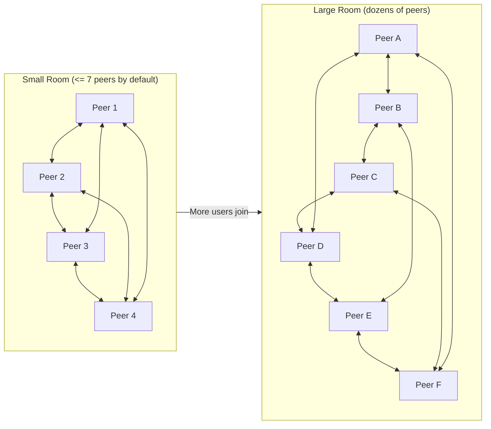

# Scaling Large Rooms (`scale()`)

[← Back to README](../README.md) · [API Reference](./api.md)

> [!NOTE] `scale()` is **experimental** and built for cooperative rooms with
> dozens of peers (tested up to 48 concurrent browser instances and 250+
> simulated peers).

In a standard WebRTC room, every browser opens a direct connection to every
other browser (a full mesh). For 2 to ~10 people — chess, poker, a band jam, a
squad hangout — a full mesh is unbeatable: lowest possible latency and smallest
bundle size.

Once a room grows to 25, 40, or 60 people — like a crowded game lobby, a
collaborative pixel canvas, or a live town hall — asking every laptop and phone
to juggle dozens of simultaneous WebRTC connections starts eating CPU and
sockets.

Opting into `scale()` solves that in one line:

```js
import {joinRoom, scale} from 'trystero'

const room = joinRoom(
  {
    appId: 'canvas.example.com',
    use: [scale()]
  },
  'plaza-1'
)
```

_(Apps that don't import `scale` tree-shake the entire multi-hop engine out of
their bundle.)_

---

## How `scale()` adapts as a room grows



1. **Small groups stay direct**: While the room has `maxDirectPeers + 1` or
   fewer peers (`7` peers or fewer at the default `maxDirectPeers: 6`), everyone
   connects directly in a full mesh with zero multi-hop routing overhead.
2. **Large groups form a gossip network**: As more people join, each browser
   maintains roughly `maxDirectPeers` direct WebRTC neighbor links and routes
   messages, RPCs, and state updates across hops to reach everyone else in the
   room.
3. **Your app code doesn't change at all**: `makeUserState`, `makeState`,
   `makeAction`, `addStream`, `replaceTrack`, `ping`, `onUserJoin`,
   `onUserLeave`, `getUsers()`, and [`roles()`](./roles.md) work identically
   whether a peer is 1 hop away or 3 hops away.

---

## Tuning `maxDirectPeers`

Pass `maxDirectPeers` (`4..32`, default `6`) to trade off per-browser connection
count against hop count:

```js
const room = joinRoom(
  {
    appId: 'canvas.example.com',
    use: [
      scale({
        maxDirectPeers: 8 // target direct WebRTC neighbors per peer (4..32)
      })
    ]
  },
  'plaza-1'
)
```

> **`maxDirectPeers` vs `maxUsers`:** `maxDirectPeers` controls how many direct
> WebRTC neighbor links each browser maintains under the hood — **not** how many
> people can join the room. To cap total room membership, use
> [`maxUsers`](./identity.md#capping-room-size-configmaxusers) on `joinRoom()`.

---

## Media streams & large file transfers in scaled rooms

Routing real-time video or a 100 MB file drop through random bystanders'
browsers would waste their bandwidth and add lag. Instead, Trystero handles
heavy traffic smartly:

- **Small messages, RPC & state (`<= 16 KiB`)** route directly over the
  multi-hop overlay (with end-to-end encryption on targeted messages).
- **Audio/video (`addStream` / `replaceTrack`) and chunked binary transfers
  (`> 16 KiB`)** automatically promote the target peer(s) to a **direct 1-hop
  WebRTC connection** on demand!
- Because promoted media and large file links bypass intermediate hops, a
  broadcaster streaming webcam video to 20 viewers still opens direct WebRTC
  links to those 20 viewers (temporarily exceeding `maxDirectPeers`). Always
  `await room.addStream(...)` or `await action.send(...)` if you want to catch
  promotion failures.

---

## Inspecting the live network (`room.getTopology()`)

When `scale()` is enabled, `room` exposes `getTopology()` so you can visualize
your mesh, inspect hop counts, or log routing stats (wait for `await room.ready`
first if you need your local `peerId` populated):

```js
await room.ready

const topology = room.getTopology()
console.log({
  myPeerId: topology.peerId,
  directNeighbors: topology.directPeerIds,
  everyoneInRoom: topology.roomPeerIds,
  routes: topology.routes, // { [peerId]: { nextHop, hops } }
  stats: topology.stats // { messagesSent, messagesReceived, messagesForwarded, ... }
})
```

You can also inspect per-peer hop distance on `room.getPeers()` — each entry
includes `{userId, connection, direct, hops, roles}` (`direct: true, hops: 1`
for direct WebRTC neighbors; `connection: null, direct: false, hops >= 2` for
multi-hop peers).

<details>
  <summary>Deep dive: multi-ring expander topology, E2E unicast crypto & threat model</summary>

- **Room-salted multi-ring expander**: Beyond `maxDirectPeers + 1` peers, nodes
  arrange themselves across `floor(maxDirectPeers / 2)` independent room-salted
  permuted Hamiltonian cycles, yielding symmetric target degree
  `<= maxDirectPeers` and `O(log N)` network diameter (under burst joins, actual
  direct neighbor counts can exceed `maxDirectPeers` due to soft inbound
  ceilings and component-bridge admissions).
- **Mutual link-state confirmation**: Peers advertise signed link-state
  descriptors (180 s TTL, refreshed by heartbeats and verified traffic, with a
  1.2 s churn grace window). Shortest-path routing tables only traverse edges
  confirmed by _both_ endpoints and enforce a dynamic hop ceiling derived from
  the verified roster size so unreachable ghost nodes are never surfaced.
- **End-to-end signatures & unicast encryption**: Every peer generates ephemeral
  ECDSA P-256 signing and ECDH P-256 encryption keys. Link descriptors, leave
  notices, broadcasts, and unicast headers are signed and bound to `appId`,
  `roomId`, and a per-origin monotonic sequence counter (`seq`) with sliding
  replay-window deduplication and 60-second freshness bounds. Point-to-point
  messages (`target`) are end-to-end encrypted between sender and recipient via
  `ECDH + AES-256-GCM` (12-byte IV, canonical header AAD) so intermediate
  browser hops cannot read targeted traffic or forge any peer's messages.
- **Cooperative routing trust model**: Cryptographic authenticity, replay
  protection, and unicast confidentiality hold even if intermediate peers are
  curious or untrusted. However, because peers forward packets for one another,
  an authenticated room member who modifies their client could drop packets
  routed through them or open extra tabs up to per-user and room caps — use room
  `password`s and [`roles()`](./roles.md) (`room.ban()`) when moderating
  untrusted rooms.

</details>
