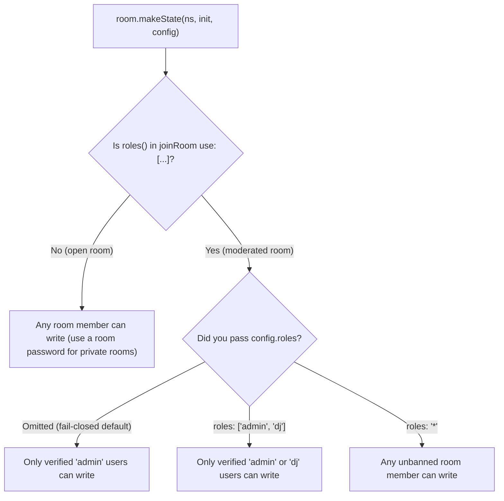

# Shared & Per-User State

[← Back to README](../README.md) · [API Reference](./api.md)

While [`makeAction`](./actions.md) is built for one-off events, RPC calls, and
binary transfers, most multiplayer apps also need **current state** that stays
in sync across everyone in the room — including people who join five minutes
late.

Trystero gives you two built-in state primitives right on `room`:

| Primitive                                 | Best for                                                      | Who can write                                                                                 | Lifecycle                                                                                         |
| ----------------------------------------- | ------------------------------------------------------------- | --------------------------------------------------------------------------------------------- | ------------------------------------------------------------------------------------------------- |
| **`room.makeUserState(ns, init?, cfg?)`** | Display names, avatars, cursors, ready flags, player loadouts | **Only that `userId`** (their own slot)                                                       | **Presence-scoped** — lives while the user is in the room, evicted right after they leave         |
| **`room.makeState(ns, init?, cfg?)`**     | Game boards, timers, watch-party playback, synth patterns     | **Any room member** _(or `'admin'` / specific roles when [`roles()`](./roles.md) is enabled)_ | **Room-scoped** — cached and relayed to newcomers by remaining peers even after the author leaves |

> **Golden rule:** Never store a `{[userId]: ...}` map inside a shared
> `makeState` (`players.set(prev => ({...prev, [me]: ...}))`). If two people
> update at the same instant, one overwrites the other. Whenever each person
> owns their own entry, reach for **`makeUserState`** instead.

---

## Per-user state (`room.makeUserState`)

`room.makeUserState(namespace, initialValue?, config?)` gives every participant
a cryptographically signed JSON slot keyed by their [`userId`](./identity.md)
(`initialValue` defaults to `null`). Nobody else can overwrite or clear your
slot — even when state is synced to newcomers by other peers or routed across
multiple hops.

```js
import {joinRoom} from 'trystero'

const room = joinRoom({appId: 'oedipa/dungeon-crawl'}, 'tavern-1')

const player = room.makeUserState('player', {
  name: 'Stranger',
  hp: 100,
  ready: false
})

// Set your initial profile right after joining — flushed automatically before
// `onUserJoin` fires on connected peers!
player.set({name: 'Oedipa', hp: 100, ready: true})

// Already populated when someone joins
room.onUserJoin(({userId}) => {
  console.log(`${player.get(userId).name} entered the tavern`)
})

// Still readable inside `onUserLeave`, then cleaned up right after
room.onUserLeave(({userId}) => {
  console.log(`${player.get(userId).name} wandered off`)
})

// Listen to live changes and departures
player.onChange((value, {userId, prev, self, removed}) => {
  if (removed) {
    console.log(`${prev.name} (${userId}) cleared their state or left`)
  } else {
    console.log(`${userId} updated:`, value, self ? '(you)' : '')
  }
})

// Frozen `{ [userId]: value }` snapshot of everyone who has published
console.log(player.getAll())
```

### Reading, updating, and clearing user state

- **`player.get(targetId?)`**: Pass a `userId` (or `peerId`) to read that user's
  slot, or call `player.get()` with no arguments to read your own. Returns
  `initialValue` if that user hasn't published yet or has left.
- **`player.getAll()`**: Returns a frozen, reference-stable
  `{ [userId]: value }` object containing all active published entries
  (including yourself once you call `.set()`).
- **`player.has(targetId?)`**: Returns `true` if that user (or you, with no
  arguments) currently has a published value — handy when `initialValue` is
  `null` and you want to tell "explicitly called `.set(null)`" apart from
  "hasn't published yet."
- **`player.set(valueOrUpdater)`**: Accepts either a JSON value or a functional
  updater (`prev => ({...prev, ready: true})`). Updates local `.get()` and
  `.getAll()` synchronously right away so your UI never lags, while coalescing
  rapid updates (like dragging a slider or moving a cursor) on the wire.
- **`player.clear()`**: Clears your local slot, resets `.has()` to `false`, and
  broadcasts a signed removal so other peers fire `onChange` with
  `removed: true`.
- **`player.getMeta(targetId?)`**: Returns metadata for the latest update
  (`{prev, peerId, userId, roles, timestamp, self, online, removed}`) or `null`
  if unpublished.

### Multi-tab friendly by default

Because `makeUserState` is keyed by `userId` rather than raw browser tabs:

- Opening a second tab in the same browser won't clobber state published from
  your first tab.
- Updates sync across all of your open tabs automatically.
- Your entry stays live in the room until your **last** open tab disconnects.

---

## Shared room state (`room.makeState`)

`room.makeState(namespace, initialValue?, config?)` keeps a single shared JSON
value synchronized across the room (`initialValue` defaults to `null`), ready to
call synchronously right after `joinRoom()`:

```js
const playback = room.makeState('playback', {
  trackUrl: 'https://example.com/synthwave.mp3',
  positionSec: 0,
  paused: true
})

playback.onChange((next, {prev, userId}) => {
  console.log(`${userId} updated playback from`, prev, 'to', next)
  syncMediaElement(next)
})

// Update directly or pass a functional updater
await playback.set(prev => ({...prev, paused: false}))

// Read current value and metadata anywhere
console.log(playback.get(), playback.getMeta())
```

If someone joins the watch party 20 minutes in — even if the person who pressed
play has since closed their tab — the remaining peers automatically verify and
sync the latest signed `playback` state to the newcomer.

> **Want shared state to survive even when every browser tab closes?** Run a
> lightweight
> [`passive: true` backup peer in Node, Bun, or Deno](./server-side.md) that
> declares the same `room.makeState(...)` namespaces.

---

## Using state with React (`useSyncExternalStore`)

Both `makeUserState` and `makeState` implement React's `useSyncExternalStore`
contract out of the box:

- `onChange` returns an `unsubscribe` function.
- `userState.getAll` and `state.get` return frozen, reference-stable snapshots.
- Calling `.set()` updates local snapshots synchronously before sending on the
  wire, so controlled inputs (`<input value={...} />`) feel instant without
  cursor jumping.

No `useEffect`, manual state mirroring, or `onUserJoin` / `onUserLeave`
bookkeeping needed:

```jsx
import {joinRoom} from 'trystero'
import {useSyncExternalStore} from 'react'

const room = joinRoom({appId: 'jam-board.example.com'}, 'studio-1')
const color = room.makeUserState('color', '#ff6b6b')
const title = room.makeState('title', 'Untitled Jam')

color.set('#ff6b6b')

export default function Studio() {
  const myColor = useSyncExternalStore(color.onChange, () => color.get())
  const everyone = useSyncExternalStore(color.onChange, color.getAll)
  const boardTitle = useSyncExternalStore(title.onChange, title.get)

  return (
    <main>
      <input value={boardTitle} onChange={e => title.set(e.target.value)} />

      <input
        type="color"
        value={myColor}
        onChange={e => color.set(e.target.value)}
      />

      <ul>
        {Object.entries(everyone).map(([userId, hex]) => (
          <li key={userId} style={{color: hex}}>
            {userId}
          </li>
        ))}
      </ul>
    </main>
  )
}
```

> **SSR tip (Next.js, Remix, Astro):** Guard module-scope `joinRoom()` calls
> behind `typeof window !== 'undefined'` (or create the room lazily on the
> client) so WebRTC setup only runs in the browser.

---

## Custom validation & size limits

Both `makeState` and `makeUserState` accept an optional `config` object as their
third argument:

- **`validate(next, context)`**: A synchronous predicate returning `true` or
  `false`. Invalid updates are rejected locally (rejecting `.set()`) _and_
  dropped automatically if received from a remote peer.
- **`maxBytes`**: Maximum UTF-8 JSON byte size per entry (defaults to `16384`
  bytes / 16 KiB, configurable up to `65536` bytes / 64 KiB).
- **`roles`**: Restricts which roles can write when [`roles()`](./roles.md) is
  enabled.

```js
const score = room.makeUserState('score', 0, {
  maxBytes: 1024,
  validate: next =>
    typeof next === 'number' && Number.isInteger(next) && next >= 0
})
```

> **Tip for `makeState` validators:** When multiple users can write
> concurrently, validate the shape and invariants of `next` (and `context.roles`
> / `context.userId`) rather than strict step-by-step transitions on
> `context.prev`, since concurrent updates resolve via last-writer-wins.

---

## Open rooms vs. authoritative state (`roles()`)

How `makeState` handles write permissions depends on whether you load the
[`roles()`](./roles.md) plugin:



- **Without `roles()` (open mode)**: Any peer in the room can update
  `makeState`. Every update still carries an unforgeable `userId` signature, and
  updates converge via whole-value **last-writer-wins (LWW)**. This is great for
  casual co-op apps among friends (especially paired with a room `password`). If
  you need character-by-character collaborative text editing, layer a CRDT like
  Yjs or Automerge over [`makeAction`](./actions.md).
- **With [`roles()`](./roles.md) (fail-closed by default)**: Loading `roles()`
  automatically locks `makeState` down to `roles: ['admin']` so you never
  accidentally leave game state open to console tampering. You can grant write
  access to custom roles (`{roles: ['admin', 'dj']}`), opt a specific shared
  state back into open writes (`{roles: '*'}`), or restrict a `makeUserState`
  namespace to seated players (`{roles: ['admin', 'player']}`).

---

## Replaying existing state to late listeners

By default, `state.onChange` and `userState.onChange` fire on **new** changes
after you subscribe. If you attach a listener later in your app's lifecycle and
want it called immediately with whatever state is already live, pass
`{replay: true}`:

```js
// Fires immediately if `playback` has already been updated, then on future changes
const unsub = playback.onChange((value, meta) => renderPlayer(value, meta), {
  replay: true
})
```

All `onChange` listeners also accept `{once: true}` and `{signal}` (an
`AbortSignal` for automatic cleanup).

<details>
  <summary>Deep dive: signed state envelopes, Hybrid Logical Clocks & anti-entropy sync</summary>

- **Unified signed records**: Every `makeState` (`k: 's'`) and `makeUserState`
  (`k: 'u'`) write or `clear()` tombstone is canonicalized and signed with the
  author's ECDSA P-256 `UserIdentity` key, binding `appId`, `roomId`, `ns`,
  `hlc`, `peerId`, `userId`, `pub`, the canonical JSON value (or tombstone bit),
  and any inline `RoleCertificate` signature.
- **40 ms wire coalescing & optimistic local reads**: Calling `.set()` or
  `.clear()` updates local `.get()` / `.getAll()` and emits local `onChange`
  synchronously right away (deferring pre-`ready` optimistic apply only on
  role-gated namespaces until local identity and roles resolve). Rapid
  back-to-back writes coalesce ECDSA signing and wire broadcasts over a 40 ms
  per-slot window so `pointermove` or slider drags stay silky smooth.
- **Deterministic LWW with skew-bounded Hybrid Logical Clocks**: Concurrent
  writes to the same slot converge across all peers using the total order
  `([wallMs, counter], userId, peerId, sig)`. Peers reject records dated more
  than 10 seconds ahead of local wall clock (or up to `cert.iat + 10s`, capped
  at 60 seconds, for role-certified writes) so a misconfigured or griefing clock
  in an open room cannot pin a far-future timestamp.
- **Per-user quotas**: Each `userId` can publish up to `32` `makeUserState`
  namespaces totaling up to `64 KiB` of active serialized JSON across the room,
  preventing memory exhaustion from any single participant.
- **Handshake push & 1-RTT anti-entropy**: Initial `makeUserState` values set
  right after `joinRoom()` flush during admission before `onUserJoin` fires on
  direct peers. Peers also reconcile full room state via cursor-paged digest
  anti-entropy sync so newcomers and reconnecting subgraphs converge even across
  multi-hop topologies or after the original author has left. Calling
  [`room.ban(userId)`](./roles.md) immediately purges all state authored by the
  banned user across peers.

</details>
