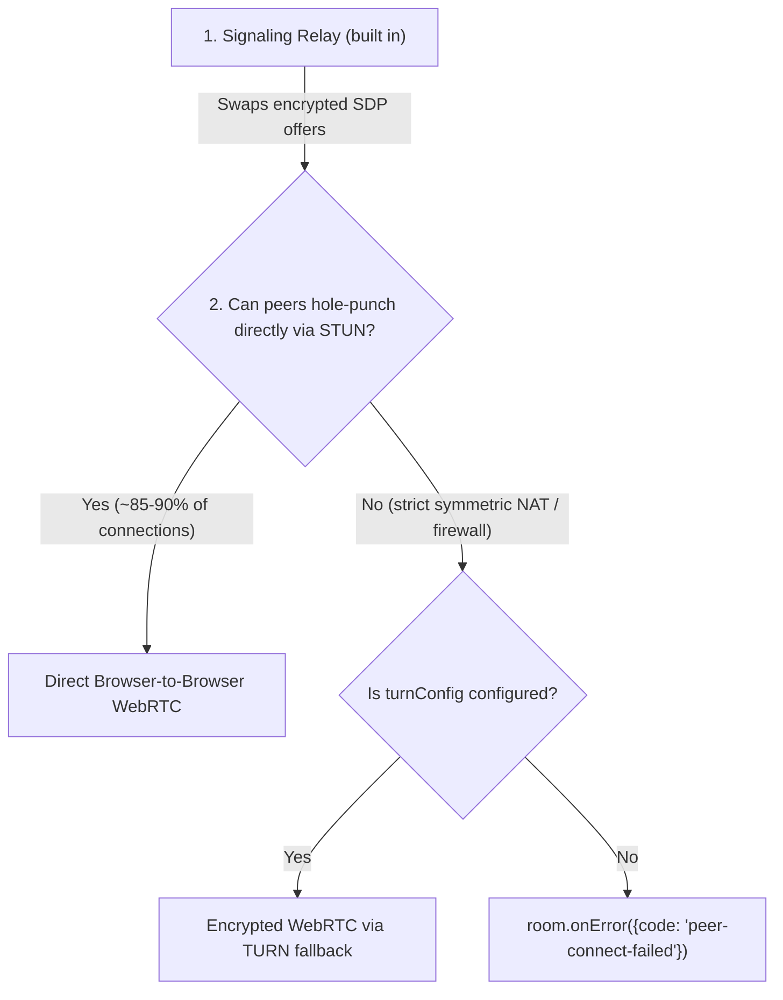

# NAT Traversal, TURN Servers & Troubleshooting

[← Back to README](../README.md) · [API Reference](./api.md)

On most home Wi-Fi and mobile networks, Trystero's built-in STUN servers punch
through routers automatically so two browsers connect directly peer-to-peer with
zero configuration.

However, roughly 10–15% of real-world internet connections — strict corporate
firewalls, university dorms, cellular carrier-grade NATs, or certain VPNs —
block direct UDP hole-punching altogether. When both peers sit behind
restrictive NATs, WebRTC needs a **TURN server** as a fallback packet relay.

---

## Signaling vs. STUN vs. TURN



- **Signaling** (Nostr, MQTT, `ws-relay`, etc.) helps two browsers _find_ each
  other and trade connection coordinates.
- **STUN** (included by default via Google & Cloudflare STUN servers) lets each
  browser discover its own public IP/port for direct hole-punching.
- **TURN** (optional via `turnConfig`) acts as an encrypted packet bounce-server
  **only** for the specific peer pairs whose firewalls refuse direct P2P. Even
  when routed through TURN, WebRTC DTLS traffic remains end-to-end encrypted
  between the two browsers.

---

## Adding a TURN server (`turnConfig`)

1. **Confirm it's a NAT/firewall issue**: If two browsers on your own machine
   (or home Wi-Fi) connect fine, your Trystero code and signaling are working!
   Check `room.onError` for `err.code === 'peer-connect-failed'`
   (`err.turnConfigured` will be `false`).
2. **Grab a TURN service (or self-host)**:
   - **Hosted tiers**:
     [Cloudflare Realtime TURN](https://developers.cloudflare.com/calls/turn/)
     (generous free monthly bandwidth tier) or
     [Metered Open Relay](https://www.metered.ca/stun-turn).
   - **Self-hosted open source**: [coturn](https://github.com/coturn/coturn),
     [eturnal](https://github.com/processone/eturnal),
     [Pion TURN](https://github.com/pion/turn), or
     [Violet](https://github.com/paullouisageneau/violet).
3. **Pass `turnConfig` to `joinRoom()`**:

```js
import {joinRoom} from 'trystero'

const room = joinRoom(
  {
    appId: 'your-domain.example/chat',
    turnConfig: [
      {
        urls: [
          'turn:turn.your-domain.example:3478?transport=udp',
          'turns:turn.your-domain.example:5349?transport=tcp'
        ],
        username: 'ephemeral-user',
        credential: 'ephemeral-password'
      }
    ]
  },
  'room-1'
)
```

> **Production tip:** Don't hardcode long-lived TURN credentials in public
> frontend code where scrapers can borrow your quota — mint short-lived TURN
> credentials from a tiny serverless function (Cloudflare Workers, Vercel, etc.)
> and pass them into `joinRoom()`.

### Custom `rtcConfig` & `trickleIce`

- **`rtcConfig`**: Pass a custom
  [`RTCConfiguration`](https://developer.mozilla.org/en-US/docs/Web/API/RTCPeerConnection/RTCPeerConnection#parameters)
  object. Servers in `turnConfig` are appended to `rtcConfig.iceServers` (or to
  Trystero's default STUN servers if `rtcConfig.iceServers` is omitted). Pass
  `rtcConfig: {iceServers: []}, turnConfig: [...]` +
  `iceTransportPolicy: 'relay'` if you ever want to force TURN-only mode for IP
  privacy.
- **`trickleIce`**: Sends ICE candidates incrementally (`true` by default on
  Nostr, MQTT, Supabase, Firebase, and `ws-relay`; `false` by default on
  BitTorrent so offers stay self-contained for trackers).

---

## Measuring latency & inspecting connections

### Round-trip ping (`room.ping`)

Measure live WebRTC data-channel round-trip time (in milliseconds) to any
connected `userId` or `peerId`:

```js
room.onUserJoin(({userId}) => {
  const timer = setInterval(async () => {
    try {
      const rttMs = await room.ping(userId)
      updateSignalBars(userId, rttMs)
    } catch {
      clearInterval(timer)
    }
  }, 5000)
})
```

### Checking relay & peer status

```js
import {getRelaySockets} from 'trystero'

// 1. Are signaling relays reachable? (nostr, mqtt, torrent, ws-relay)
console.log(getRelaySockets())

// 2. Who is connected right now, and are they direct (1-hop) or multi-hop?
console.log(room.getUsers()) // { [userId]: { peerIds, roles } }
console.log(room.getPeers()) // { [peerId]: { userId, connection, direct, hops, roles } }
```

---

## Common gotchas & quick fixes

| Symptom                                                                          | Why it happens & how to fix it                                                                                                                                                                                                                                                                    |
| -------------------------------------------------------------------------------- | ------------------------------------------------------------------------------------------------------------------------------------------------------------------------------------------------------------------------------------------------------------------------------------------------- |
| **`onUserJoin` doesn't fire when I open a second tab on my laptop**              | Tabs in the same browser profile share your persistent `'local'` `userId`, so Trystero sees one user with two tabs (`onPeerJoin` fires, `onUserJoin` doesn't). Open an **Incognito/Private** window — or pass `identity: 'none'` — to test two distinct users locally!                            |
| **Unknown peers appear in my room (or incoming state/actions look unfamiliar)**  | Default public relays share a global `(appId, roomId)` namespace. Using a generic `appId` like `'my-app'` or `'chess'` with a common room name like `'lobby'` can connect you to another developer's room — use a domain (`'chess.example.com'`, `'example.com/chess'`) or `'username/app-name'`. |
| **`Error: already joined room "..." for appId "..."`**                           | Calling `joinRoom()` twice for an active `(appId, roomId)` throws instead of returning the old room (for example, inside React StrictMode double-mounts). Call `await room.leave()` in cleanup, or initialize the room outside the component render cycle.                                        |
| **`ReferenceError: window / RTCPeerConnection is not defined` in Next.js / SSR** | `joinRoom()` opens WebRTC/relay connections immediately. Guard client room creation behind `typeof window !== 'undefined'` or create the room inside a client-only module/hook.                                                                                                                   |
| **Guests get an error joining `my-room~9fX2...`**                                | Room IDs containing `~<userId>` are self-certifying admin rooms created with `roles({selfAsAdmin: true})`. Guests must include `use: [roles()]` in their `joinRoom()` config so their browser verifies host permissions.                                                                          |
| **Large files > 256 MiB are declined automatically**                             | Rooms default to a `256 MiB` concurrent receive budget (`maxReceiveBytes`). Pass a higher `maxReceiveBytes` in `joinRoom()` on receivers if your app transfers larger files.                                                                                                                      |
